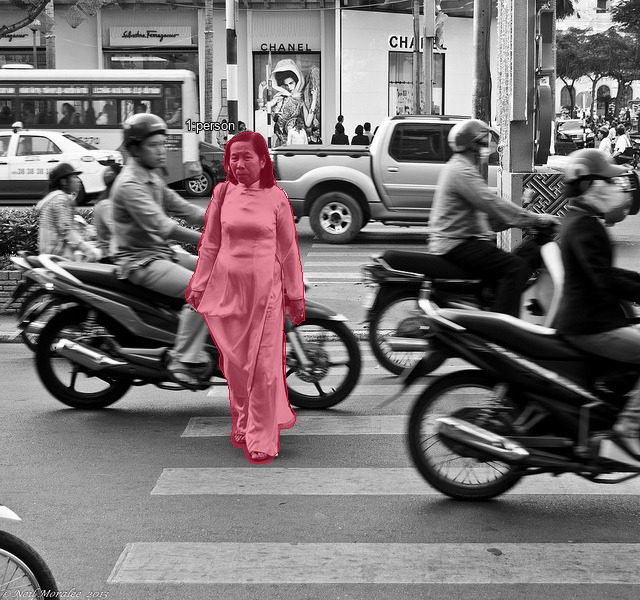
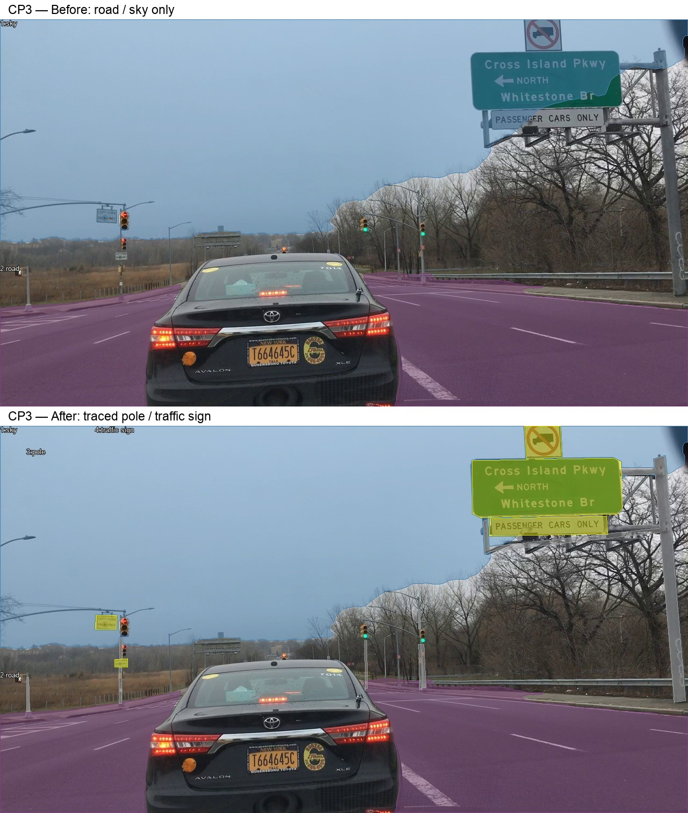

# Báo cáo thực hành Day03 — Trần Xuân Bắc

- Mã học viên / MSSV: **2A202603132** — lớp **L2A**.
- Ngày thực hành: **11/11/2026**. CVAT local: `http://localhost:8080`.
- Phần tự vẽ: tôi vẽ tay ở hai task **Easy và Medium** trên CVAT. Object person đầu tiên của Medium được tự vẽ trước khi đưa gợi ý vào task.
- Công cụ: CVAT, Python, Mask2Former và Codex. Trong vòng hoàn thiện sau đó, công cụ hỗ trợ tạo gợi ý, bổ sung và sửa mask, rà ảnh và kiểm tra export; phần hỗ trợ này được phân biệt với phần tôi tự vẽ tay.
- Tự kiểm: sau vòng hỗ trợ, tôi đã tự rà toàn bộ 14 ảnh, sửa các điểm cần điều chỉnh và kiểm chứng lại kết quả.
- Nguồn mô hình gợi ý: [facebook/mask2former-swin-tiny-coco-panoptic](https://huggingface.co/facebook/mask2former-swin-tiny-coco-panoptic). Không dùng reference để tạo hoặc sửa mask; chưa có điểm tự đánh giá.

## 1. Bài đã nộp

Các tệp dưới đây đã Save trên CVAT và export ra ZIP. Số ảnh thể hiện ảnh có nhãn được xuất; không phải xác nhận mọi pixel/object đã đúng. Việc nộp URL repo trên LMS thực hiện riêng.

| Task | File ZIP đúng tên | Hoàn thành mấy ảnh | Điểm tối đa (coach chấm sau) |
| --- | --- | ---: | ---: |
| easy_semantic | [easy_semantic.zip](../../submissions/easy_semantic.zip) | 3 / 3 | 20 |
| medium_instance | [medium_instance.zip](../../submissions/medium_instance.zip) | 3 / 3 | 32 |
| hard_panoptic | [hard_panoptic.zip](../../submissions/hard_panoptic.zip) | 2 / 2 | 30 |
| cp1_holes | [cp1_holes.zip](../../submissions/cp1_holes.zip) | 1 / 1 | 3 |
| cp2_slice | [cp2_slice.zip](../../submissions/cp2_slice.zip) | 1 / 1 | 3 |
| cp5_occlusion | [cp5_occlusion.zip](../../submissions/cp5_occlusion.zip) | 1 / 1 | 3 |
| cp3_thin | [cp3_thin.zip](../../submissions/cp3_thin.zip) | 1 / 1 | 3 |
| cp4_curb | [cp4_curb.zip](../../submissions/cp4_curb.zip) | 1 / 1 | 3 |
| cp6_coverage | [cp6_coverage.zip](../../submissions/cp6_coverage.zip) | 1 / 1 | 3 |
| **Tổng tối đa** | **9 ZIP, 14 ảnh** | | **100** |

Easy, CP3, CP4, CP6 dùng **Segmentation mask 1.1**; Medium, Hard, CP1, CP2, CP5 dùng **COCO 1.0**. Giữ nguyên nội dung ZIP xuất từ CVAT.

Kiểm cấu trúc bằng `python3 scripts/inspect_submissions.py --dir submissions`: **9/9 ZIP hợp lệ, không thiếu task**. Kiểm bổ sung giải mã PNG/RLE, đối chiếu từng mask với CVAT, kích thước ảnh và chồng lấn: xem [kết quả đối chiếu](assets/day3/export_verification.json) và [kiểm cấu trúc](assets/day3/structure_qc.json). Các kiểm tra này không chứng minh đủ vật hoặc biên chính xác; không thay điểm của coach.

**Tự QC:** sau vòng rà có hỗ trợ, tôi đã tự kiểm tra toàn bộ 14 ảnh và xác nhận hoàn tất việc rà, sửa, kiểm chứng. Danh sách ảnh nằm trong kết quả đối chiếu; ảnh overlay lưu tại [thư mục QC](assets/day3/qc/). Việc tự kiểm không thay điểm chấm theo reference hoặc loại trừ mọi sai sót ở vật nhỏ, biên mảnh.

## 2. Một quyết định trước khi dùng gợi ý

- **Ảnh, vị trí, object tự vẽ:** `000000181542.jpg`, người phụ nữ mặc áo dài sáng màu ở giữa ảnh đen trắng; class `person`. Đã tự vẽ và Save trong [Medium, job 6](http://localhost:8080/tasks/6/jobs/6) trước khi các gợi ý được đưa vào task.
- **Quyết định biên và tự kiểm:** ở lần vẽ đầu tôi chưa chắc biên; sau đó tôi đã tự rà và kiểm chứng lại mask person. Quy tắc đối chiếu là bám phần người nhìn thấy, không lấy nền đường hoặc xe máy sát cạnh, không suy đoán phần bị che. Các vùng cần chú ý là tóc, tay, vạt áo và chân. Đây là xác nhận sau khi tự rà, không phải khẳng định tôi đã chắc chắn ngay ở lần vẽ đầu.
- **Sau khi có gợi ý:** trong vòng xử lý có hỗ trợ, mask person gợi ý trùng object này được bỏ; mask tự vẽ được giữ nguyên và các mask khác không đè lên vùng người đã lưu. Bằng chứng đối chiếu của vòng export được lưu cùng báo cáo. Tôi đã tự kiểm chứng lại kết quả sau đó.

## 3. Một lỗi tìm thấy và sửa khi rà có hỗ trợ

Lỗi dưới đây được phát hiện và xử lý trong vòng hỗ trợ; sau đó tôi đã tự quan sát, đối chiếu và kiểm chứng lại.

- **Task/ảnh/vùng:** `cp3_thin`, ảnh `839f7736-abe28069.jpg`; cụm biển chỉ đường và cột đỡ ở phía trên bên phải.
- **Loại lỗi:** thiếu lớp/vùng và biên mảnh. Gợi ý ban đầu chỉ có `road` và `sky`, bỏ sót `pole` và `traffic sign`; một phần biển còn nằm trong sky.
- **Bằng chứng:** biển xanh, biển trắng bên dưới và cột kim loại nhìn thấy rõ trên ảnh, nhưng chưa có mask đúng lớp trong bản gợi ý đầu.
- **Sửa với hỗ trợ:** vẽ theo vùng nhìn thấy của biển/cột, tách phần này khỏi sky/road; gộp các phần cùng lớp thành vùng semantic. Không gán nhánh cây thành cột và không tô toàn bộ vùng nền quanh biển.
- **Trạng thái:** đã lưu tại CVAT task 12/job 12 và export lại `cp3_thin.zip`. ZIP có đủ bốn lớp trong labelmap; giải mã mask khớp bản đã Save. Sau vòng sửa có hỗ trợ, tôi đã tự xem lại và kiểm chứng kết quả; các nhánh/cột nhỏ và biên quanh đèn tín hiệu là những vùng cần đối chiếu kỹ.
- **Kết quả scorer:** chưa chạy scorer với reference, chưa có mIoU/PQ hoặc điểm. Không suy điểm từ việc checker báo OK.

Các lỗi khác đã được sửa trong vòng rà có hỗ trợ và sau đó được tôi tự kiểm chứng: nối hai phần của cùng xe máy bị người che ở Medium; bỏ trụ cứu hỏa bị gán nhầm `person` tại CP6; thêm phần xe buýt bị cắt ở mép trái CP2; giữ các xe chở trên xe vận chuyển ở Hard thành instance riêng.

## 4. Ba ca chưa chắc hoặc đã cân nhắc

| Ảnh/vị trí | Hai cách hiểu có thể | Quy tắc/chứng cứ | Quyết định hoặc câu hỏi cho coach |
| --- | --- | --- | --- |
| CP1 — `000000144300.jpg`, caravan bên trái sau xe máy | Xe dạng caravan có thể bị nhầm `bus`/`truck`, hoặc nằm ngoài sáu lớp task | Có cửa sổ và thân dạng nhà lưu động; schema không có lớp caravan. Hình dáng này chưa đủ để kết luận chắc chắn bus | Bản hiện tại giữ lớp `bus` từ gợi ý; cần coach xác nhận quy ước cho caravan. Chưa khẳng định class này đúng. [Ảnh rà](assets/day3/qc/cp1_holes/000000144300.jpg) |
| CP4 — `7d83710e-4697c3b2.jpg`, bó vỉa cong và ô đất quanh gốc cây phía phải | Có thể gán theo màu mặt đất hoặc theo chức năng road/sidewalk | Mép bó vỉa ngăn mặt đường và lối đi; ô đất, thân cây và túi rác không phải mặt lát sidewalk | Theo bó vỉa; loại các vùng vật che/ô đất ra khỏi mask mặt đường và vỉa hè. Đã tự rà lại ranh sát chân bó vỉa. [Ảnh rà](assets/day3/qc/cp4_curb/7d83710e-4697c3b2.jpg) |
| CP6 — `7daa6479-67988f3f.jpg`, xe buýt lớn giữa ảnh và trụ cứu hỏa cạnh phải xe | Tô xe buýt thành `car` để kín ảnh hoặc để ngoài schema; trụ cứu hỏa dễ bị nhầm `person` | Schema không có `bus`/`truck`; trụ cứu hỏa là vật cố định, không phải người | Để xe buýt/xe tải và trụ cứu hỏa ngoài các lớp đích; giữ vùng nhìn thấy của người thật phía phải. Không ép coverage bằng lớp sai. [Ảnh rà](assets/day3/qc/cp6_coverage/7daa6479-67988f3f.jpg) |
